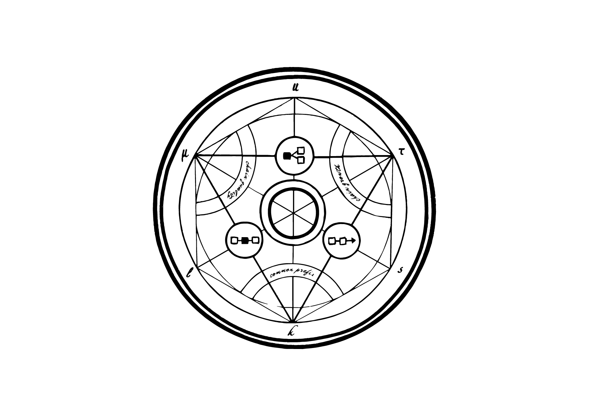

<picture>
    <source srcset="https://github.com/commonprefix/.github/blob/18c83a92c7273753c213750eca1b2807ad75d572/profile/cp-logo-inversed.png?raw=true" width="auto" height="180" media="(prefers-color-scheme: dark)">
    
</picture>

### Building trust technologies to create certainty in mission-critical systems.

Common Prefix combines research and engineering to build trust technologies that provide assurance in high-stakes environments. We ensure that the infrastructure our customers depend on is correct, safe, secure, and compliant, with provable guarantees. Our products use agent-driven formal proofs to reduce risk, drawing on cryptography, game theory, consensus, distributed systems, and beyond.

## Products

* **[Coder](https://www.commonprefix.com/coder)**: software, proven correct. An AI coding agent: describe what you need, and it writes the software, then proves in Lean 4 that it does what you asked, or shows you a counterexample.
* **[Axelar](https://www.axelar.network/)**: the interoperability network for moving assets and messages between blockchains. Common Prefix has worked on Axelar since 2021 and leads its stewardship since late 2025: technology direction, product and the [2026 roadmap](https://www.commonprefix.com/blog/axelar-roadmap).

## Partners

We work with networks, foundations and companies that run mission-critical infrastructure, from finance to blockchains:

[Axelar](https://www.commonprefix.com/clients/axelar) · [Ripple](https://www.commonprefix.com/clients/ripple) · [XRP Ledger Foundation](https://www.commonprefix.com/clients/xrplf) · [pod](https://www.commonprefix.com/clients/pod) · [Mysten Labs](https://www.commonprefix.com/clients/mysten) · [Babylon](https://www.commonprefix.com/clients/babylon) · [Celestia](https://www.commonprefix.com/clients/celestia) · [Espresso Systems](https://www.commonprefix.com/clients/espresso) · [BOB](https://www.commonprefix.com/clients/bob) · [Citrea](https://www.commonprefix.com/clients/citrea) · [Flashbots](https://www.commonprefix.com/clients/flashbots) · [Sei](https://www.commonprefix.com/clients/sei) · [Quai Network](https://www.commonprefix.com/clients/quai) · [Pi Squared](https://www.commonprefix.com/clients/pi2) · [Snowfork](https://www.commonprefix.com/clients/snowfork) · [dcSpark](https://www.commonprefix.com/clients/dcspark) · [Bifrost](https://www.commonprefix.com/clients/bifrost) · [Harmony](https://www.commonprefix.com/clients/harmony) · [=nil; Foundation](https://www.commonprefix.com/clients/nil) · [Bitpanda](https://www.commonprefix.com/clients/bitpanda) · [Zano](https://www.commonprefix.com/clients/zano)

Supported by a grant from the [Ethereum Foundation](https://www.commonprefix.com/grants/ethereum-foundation).

## Open source

**XRP Ledger**
* [xrpl-cli](https://github.com/commonprefix/xrpl-cli): a Swiss Army knife for interacting with the XRP Ledger from the command line.
* [xrpl-validator](https://github.com/commonprefix/xrpl-validator): Terraform and Ansible configuration for running XRP Ledger validator clusters on AWS.
* [rippled-formal-verification](https://github.com/commonprefix/rippled-formal-verification): our work on formally verifying the XRP Ledger. Read the [first proofs](https://www.commonprefix.com/blog/formal-verification-of-xrpl-foundations-and-first-proofs).
* [axelar-xrpl-solidity](https://github.com/commonprefix/axelar-xrpl-solidity): the Solidity contracts of the Axelar <> XRPL integration.

**Ethereum light clients and proofs**
* [Kevlar](https://github.com/commonprefix/kevlar): a light-client-based RPC proxy for PoS Ethereum that makes MetaMask, or any RPC wallet, trustless.
* [Patronum](https://github.com/commonprefix/patronum): an Ethereum RPC proxy that verifies RPC responses against trusted block hashes.
* [Ancestry prover](https://github.com/commonprefix/ancestry-prover): proves that a beacon block is a predecessor of another.
* [State prover](https://github.com/commonprefix/state-prover): Merkle inclusion proofs from Ethereum beacon blocks and states.
* [Axelar light client](https://github.com/commonprefix/axelar-light-client): an Ethereum light client on the Sync Committee protocol, bridging events from Ethereum to Axelar.

**Cryptography and learning**
* [btc-mpc](https://github.com/commonprefix/btc-mpc): distributed key generation and threshold signatures on Bitcoin.
* [The Art of Blockchain Programming](https://github.com/commonprefix/art-of-blockchain): a guide from zero to hero in web3.

## Research

Our team publishes at the venues where the field is decided: CRYPTO, EUROCRYPT, CCS, Financial Cryptography, AFT and more. Read the [papers](https://www.commonprefix.com/research), the [blog](https://www.commonprefix.com/blog), and listen to our podcast, [Honest Majority](https://www.commonprefix.com/podcast).

---

[commonprefix.com](https://www.commonprefix.com) · [Careers](https://www.commonprefix.com/careers) · [hello@commonprefix.com](mailto:hello@commonprefix.com)
